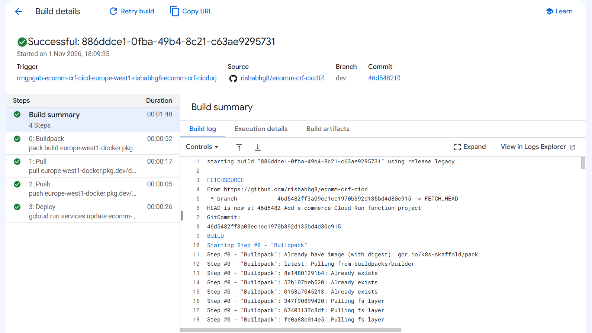

# E-commerce Order Cloud Run Function

This project contains a Python HTTP function that receives an e-commerce order, checks its contents, adds processing details, and returns a response. It uses Google Cloud Functions Framework and can run as a function on Cloud Run.

> **Important:** The project does not connect to a real database. `simulate_db_save` only logs that it would save the order and returns success. The response message says the order was stored, but no order is actually persisted.

## How the code works

1. `main.py` receives the HTTP request in `order_event`.
2. The function only accepts `POST` requests and expects a JSON body.
3. `utils/order_utils.py` checks for the required order fields, validates item and address fields, and checks that the order total matches the item quantities and prices.
4. `enrich_payload` adds a unique processing ID and the time the request was processed.
5. `simulate_db_save` stands in for a database save. It does not store data.
6. If processing succeeds, the function returns a JSON response with HTTP status `200`.

Invalid methods return `405`. Missing, invalid, or inconsistent request data returns `400`. A failure during the simulated save returns `500`.

## Example request

The total must equal the sum of each item's quantity multiplied by its unit price.

```json
{
  "order_id": "ORD-1001",
  "customer_id": "CUST-123",
  "order_date": "2026-11-01T10:00:00Z",
  "items": [
    {
      "sku": "WM-123",
      "name": "Wireless Mouse",
      "qty": 2,
      "unit_price": 25.99
    },
    {
      "sku": "KB-456",
      "name": "Keyboard",
      "qty": 1,
      "unit_price": 79.99
    }
  ],
  "shipping_address": {
    "line1": "123 Main Street",
    "city": "San Francisco",
    "state": "CA",
    "postal_code": "94107",
    "country": "USA"
  },
  "payment_method": "credit_card",
  "total_amount": 131.97
}
```

An example request for the deployed service is in [test_curl_event.txt](test_curl_event.txt). It uses `gcloud auth print-identity-token` to authenticate.

## Example success response

The processing ID and timestamp are generated for each request.

```json
{
  "status": "processed",
  "order_id": "ORD-1001",
  "processing_id": "generated-unique-id",
  "processed_at": "2026-11-01T10:00:00Z",
  "items_count": 2,
  "total_amount": 131.97,
  "payment_method": "credit_card",
  "shipping_address": {
    "line1": "123 Main Street",
    "city": "San Francisco",
    "state": "CA",
    "postal_code": "94107",
    "country": "USA"
  },
  "message": "Order received and stored."
}
```

## Cloud Run build and execution




## CI/CD

The Cloud Run service is built and deployed directly from the GitHub repository through the Cloud Run deployment flow. This lets Cloud Run build the application from the source in the connected repository when a deployment is triggered.

This project folder does not contain a separate Cloud Build configuration or GitHub Actions workflow, and it does not include an automated test suite. The deployment flow builds and deploys the service, but automated code checks and tests would need to be added separately.

## Coding practices used

- **Separate responsibilities:** `main.py` handles HTTP requests and responses, while `utils/order_utils.py` handles order validation and processing helpers.
- **Validate before processing:** Required fields, item details, shipping fields, and the calculated total are checked before the function reports success.
- **Use helper functions:** Validation, enrichment, and the save placeholder each have their own function, making the request flow easier to follow.
- **Useful logging:** The code logs request handling and processing steps, which helps when checking Cloud Run logs.
- **Return appropriate HTTP status codes:** The function uses different status codes for successful requests and common errors.
- **Generate processing metadata:** Each accepted order gets a unique processing ID and a processing timestamp.

## Project files

- `main.py`: HTTP entry point and response handling.
- `utils/order_utils.py`: Validation, payload enrichment, and simulated database save.
- `requirements.txt`: Python packages needed to run the function.
- `test_curl_event.txt`: Example authenticated request to the deployed service.
